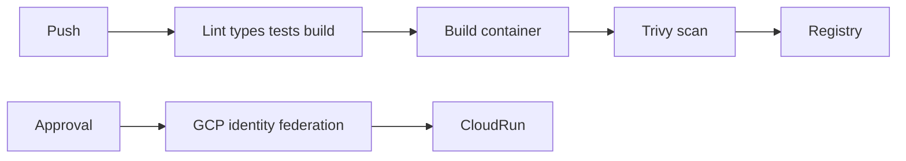

# Reusable GitHub Actions CI/CD

[](https://github.com/yashybm30/github-actions-cicd-templates/actions/workflows/ci.yml)

An independently runnable portfolio project demonstrating runnable nestjs sample used to verify release artifacts.

## Implemented behavior

- Runnable NestJS sample used to verify release artifacts
- Reusable lockfile-based Node/Nest validation with dependency cache and uploaded build artifacts
- Reusable Docker build, Trivy scan and optional post-scan GHCR push
- Manual protected Cloud Run deployment with GCP Workload Identity Federation
- Kubernetes rolling deployment and health-probe examples

## Architecture



## Requirements and setup

Node.js 24 and npm. Docker Engine with Compose v2 is needed for local databases/queues. Native browser scraping also requires Chromium. Exact dependencies and reproducible versions are in package.json/package-lock.json.

```bash
npm ci
npm run check
```

```bash
cp .env.example .env
# Edit the environment before starting; use random independent signing secrets.
docker compose --env-file .env up --build -d
```

Run one stack at a time because localhost development ports overlap. For native execution, run `npm run build`, start the documented dependencies, apply migrations where applicable, then `npm start`. Node reads `.env` for the start and SQL migration scripts; Vitest requires exported test environment variables. Bash examples use `NAME=value command`; PowerShell uses `$env:NAME='value'` before the command.

## Configuration

- `PORT`: HTTP port (default 3000).
- `JWT_SECRET`: at least 48 random characters; match the trusted issuer when using auth-service tokens.
- `JWT_ISSUER` / `JWT_AUDIENCE`: default `portfolio-auth` / `portfolio-api`.
- `CORS_ORIGIN`: comma-separated browser origins, deny cross-origin by default.
- `REDIS_URL`: local Redis connection where applicable.

## Usage and contracts

Call the reusable verifier from another repository:

```yaml
jobs:
  verify:
    uses: yashybm30/github-actions-cicd-templates/.github/workflows/reusable-node.yml@main
    permissions:
      contents: read
```

Pin reusable workflows and third-party actions to reviewed commit SHAs in controlled deployments. The Docker workflow accepts `image` and `push`; configure caller package permissions explicitly. Publishing is disabled by default. The `deploy-cloud-run.yml` workflow accepts an immutable image digest and runs only by manual dispatch against the `production` environment. Configure required reviewers and restrict protected branches in repository settings. Set environment variables `GCP_WORKLOAD_IDENTITY_PROVIDER`, `GCP_SERVICE_ACCOUNT`, `GCP_REGION`, and `CLOUD_RUN_SERVICE`. Restrict the GCP federation provider to the repository and protected ref. Grant only the deployment roles your service needs. No long-lived service-account key is used.

Run the sample with `npm run build && npm start`. It exposes `/health/live`, `/health/ready`, and `/v1/message`. Kubernetes manifests in `k8s/` need a real immutable image reference before applying.

### Authentication and health

Authenticated HTTP examples use `Authorization: Bearer $ACCESS_TOKEN`. Obtain a correctly scoped token from your trusted issuer or the portfolio auth service using the same signing/issuer/audience settings. No production debug token endpoint is exposed. GET `/health/live` verifies the process; GET `/health/ready` checks the project's primary dependencies. `/docs` exposes route documentation; request examples here define the detailed contracts.

## Validation

```bash
npm run check
```

Unit tests never imply integration success. Integration suites use disposable namespaces and test signing keys; never point them at production. Tests import compiled application modules to preserve NestJS decorator metadata. See Actions for the current hosted status. External provider calls and cloud deployments are not part of local acceptance.

## Deployment and operations

The Dockerfile uses a separate build stage and a non-root runtime. Start dependencies and migrations before the application. Compose is a local development setup. For GCP/GKE or another cloud, publish a reviewed image, inject secrets using the platform secret manager, configure private dependency connectivity, health probes and resource limits, and verify graceful shutdown. No paid cloud resource is created by this repository.

## Security and trade-offs

Bearer identity is verified with an explicit JWT algorithm, issuer, audience and structured claims. Tenant IDs come from verified tokens, not headers. New services validate access-token expiry but do not introspect the authentication service for immediate token revocation; use short-lived tokens or add an introspection boundary where required. Limits and permission checks are documented per endpoint. Use TLS, workload credentials, restricted networks, backups, request quotas and least-privilege runtime roles before real deployment.

## Known limitations

Cloud deployment workflows require your GCP project, federation, environment protection and IAM setup. They have not been run against paid infrastructure. Reusable container scanning is configured; actual scan evidence appears only when that workflow is invoked.

## Roadmap

Expand failure-mode coverage, validate external integrations in a staging account, add deployment-specific telemetry and retention policy, and review action/dependency updates regularly. Features described above are implemented; this roadmap is not a completion claim.

MIT licensed. See CONTRIBUTING.md and SECURITY.md.
